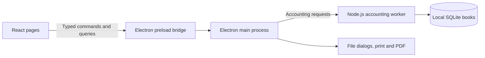

# Desktop architecture

The target is one offline Electron application with six accounting modules sharing one posting engine and one SQLite database per workspace. The accountant can move a workspace between Mac and Windows by backup and restore. See the [product specification](software.md) for workflows and the [phase tracker](phases.md) for what exists today.

## Runtime and stack

| Component | Responsibility |
| --- | --- |
| React, TypeScript and Vite | Render module pages, forms, keyboard shortcuts and reports. Retain navigation state. Load filtered, paginated results for the active firm and period. |
| Electron main and preload | Create a sandboxed window with context isolation. Expose named operations through preload, validate the calling window and handle file selection, print and PDF. Keep SQL and filesystem access on the desktop side of the bridge. |
| Node.js worker in TypeScript | Validate command input, calculate postings, review statement imports and execute report queries off the UI thread. Share command and result types with React. |
| SQLite through `node:sqlite` | Keep one writer for the workspace, use foreign keys and transactions, and version schema changes. Store live books under Electron’s user-data directory. Keep demo data in a separate workspace. |
| SheetJS and Electron printing | Read CSV and XLSX files for preview. Generate printed invoices and PDFs from the saved invoice snapshot using the same template. |
| Development and distribution | Use Vitest for posting logic and SQLite integration checks, Playwright for keyboard workflows, and electron-builder for the macOS disk image and Windows installer. Pin and smoke-test the Electron runtime with the SQLite binding on both platforms. |

## Records and ownership

| Records | Relationship |
| --- | --- |
| Firms, accounts, sites and contractor assignments | Each account and site belongs to a firm. Contractor-to-site assignments are many-to-many. A cashbook identifies its funding firm and custodian. The counterparty on a payment is recorded independently. |
| Vouchers and posting lines | Each voucher belongs to one booking firm. Each line identifies an account in that firm, a signed amount in paise and a site where applicable. Multiple contractor lines can split one bank payment across sites. |
| Invoices, allocations and bill payments | Store the invoice fields, party details, items and tax breakdown as issued. Link the invoice to its voucher. Management allocations distribute the pre-tax amount among firms. Bill-payment links support partial payments and the outstanding balance. |
| Imported statement rows | Retain the bank account, source row details, signed amount and review state. A confirmed match links the row to the relevant bank movement. A pending row has no effect on the books. |

Each workspace exposes its selected firm as `Workspace.activeFirmId`. The desktop shell pairs that ID with the workspace kind when opening the books. Use both values for entry and query requests, and capture the firm ID when initializing an entry draft. An empty workspace has no active firm. The first available firm is used by default, and an explicit selection is saved in that workspace.

Use immediate, non-cascading foreign keys to `firms.id` for book records. Removing a referenced firm archives it and preserves its ID for historical queries. New entries and the active-firm switcher use unarchived firms.

## Posting and querying

1. React sends a named command, such as `postVoucher`, with the booking firm, source details and a stable request ID. A report reads through a query such as `getLedger` with firm, account, period and optional site.
2. The worker checks account ownership, site assignments, dates, amounts and voucher rules. Use decimal arithmetic for quantities, rates and GST. Round printed tax components once to paise and post the same amounts shown on the invoice.
3. In one transaction, write the voucher, balanced posting lines and any associated invoice, allocation, bill application or statement match. Total debits must equal total credits. Repeating the same save returns the committed voucher. A failed transaction leaves the previous books intact.
4. Reports read the committed lines. A bank payment of ₹5,000 to Anuj at Yamuna debits his contractor ledger for that site and credits the bank. Bank, contractor and site views open that same voucher. A correction records a dated reversal linked to the original and unwinds affected matches and allocations.

## Voucher posting examples

Each row shows one voucher from the booking firm’s point of view.

| Entry | Debit | Credit |
| --- | --- | --- |
| Pay Anuj ₹40,000 by bank | Anuj at Yamuna ₹30,000 and Anuj at Bodla ₹10,000 | Paying bank ₹40,000 |
| Receive ₹2,000 back from Anuj for Bodla in cash | Receiving cashbook ₹2,000 | Anuj at Bodla ₹2,000 |
| Give Vikram ₹10,000 of office cash for site use | Vikram’s site cashbook ₹10,000 | Office cashbook ₹10,000 |
| Vikram pays ₹6,500 against a supplier bill already booked | Supplier payable ₹6,500, linked to the bill | Vikram’s site cashbook ₹6,500 |
| Vikram returns ₹1,000 to the office | Office cashbook ₹1,000 | Vikram’s site cashbook ₹1,000 |
| Record salary earned | Salary expense | Employee payable |
| Pay previously accrued salary by bank | Employee payable | Paying bank |
| Book a purchase invoice with recoverable GST | Purchases for the taxable value and the applicable input GST accounts | Supplier payable for the invoice total |
| Issue a taxable sale invoice on credit | Customer receivable for the invoice total | Sales for the taxable value and the applicable output GST accounts |

Matching a bank statement row to an existing payment links the evidence to the voucher. Splitting an invoice’s pre-tax value between beneficiary firms writes management allocations. Both actions preserve the posted debit and credit totals.

## Storage and recovery

Use a consistent SQLite backup of the whole workspace. Before restore, validate the selected backup and its schema version. Preserve the current books until the replacement has opened and passed integrity checks. Exercise migrations on populated copies and compare account balances, issued invoices and unresolved statement rows after recovery. The sample baseline and cross-platform release checks are in the [phase tracker](phases.md).
